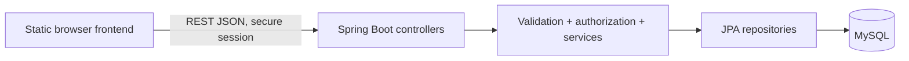

# SAMVED backend plan — 13 October 2026

**Implementation update:** Developer A's Java backend and career-page API wiring are now in `backend/` and `frontend/`. `backend/README.md` lists exact endpoints and the Christa integration seam. Java tests, app startup, Java Flyway migration against H2, and Maven packaging pass. MySQL and a full authenticated browser journey remain unverified because Christa's auth/profile code and a local MySQL server are not present. The sections below preserve the original plan and starting-point evidence; they should not be read as a current claim that no backend exists.

## Verified starting point

`anm` is the `main` branch of `AnnMariaJohny/samved-` at `f55801ce9b33b4e8608495d79e8f3577b31b6416`. `Eva/SAMVED_1/frontend` is the second contribution. Both contain static HTML, CSS, and JavaScript. The combined copy is in `frontend`. Neither source contains Java classes, a Maven or Gradle build, SQL migrations, backend tests, or working API calls. `frontend/api/api.js` is a placeholder. Eva's registration/login compare a plaintext password in browser storage; the career pages use sample data and simulated updates. These are prototype screens, not a deployed product.

The SAMVED handover supplies product intent and stack constraints. Its tables, routes, recommendation weights, and module list are proposals, not implemented contracts.

## MVP outcome and scope

A student can register and sign in, complete a profile and assessment, see explained career suggestions and skill gaps, choose a goal, receive a roadmap, manage milestones and tasks, see calculated progress, and browse curated opportunities. Guidance must state its reasons and must not claim to predict future success.

| Priority | Capability | Acceptance evidence |
| --- | --- | --- |
| P0 | Auth and private student data | Password hash in MySQL; login/logout; another student's records return 403/404; no client-supplied owner ID is trusted |
| P0 | Profile, academics, interests, skills, strengths, values, goal | Validated create/update/read returns the signed-in student's persisted data after reload |
| P0 | Assessment | Questions load; answers save once or update predictably; result is reproducible from stored answers |
| P0 | Career catalogue and guidance | Suggestions include rule version, reasons, matching factors and gaps; unknown/uncertain goal is handled honestly |
| P0 | Roadmap, milestones, tasks and progress | Student can create or select a roadmap; task/milestone status persists; progress derives from stored state, with zero-total behavior defined |
| P0 | Curated opportunities | Student can filter real, explicitly sourced or clearly demo/seeded records; expired records are identified |
| P0 | Browser integration and QA | One full student journey passes against Java + MySQL, including validation, unauthenticated, wrong-owner and unavailable-server paths |
| P1 | Bookmarks, reminders, charts | Add only after the P0 journey works; charts may summarize actual data |
| Later | Live opportunity feeds, email/push, LLM/AI claims | Require data-source, cost, privacy and evaluation decisions |

## Architecture and repository layout

Use a Java Spring Boot modular monolith with REST/JSON, MySQL, Maven and Spring Data JPA unless the course specifically requires JDBC. Put the future application in `backend/`; keep the static site in `frontend/`. Suggested packages: `common`, `config`, `security`, `auth`, `student`, `assessment`, `career`, `recommendation`, `roadmap`, `task`, `progress`, and `opportunity`. Each feature package owns its controller, DTOs, service, repository, and tests. Controllers validate and authorize; services own business rules; repositories own persistence. Never return JPA entities directly. Use Flyway migrations and an environment-based database configuration.

For the MVP, serve the static frontend and API from one Spring Boot origin. Use a server-managed `HttpOnly`, `SameSite=Lax` session cookie, `Secure` under HTTPS, and a CSRF token for unsafe requests. Do not place credentials in browser storage. Passwords need Spring Security's supported adaptive encoder and login throttling. Christa owns this slice; see `FRIEND_AUTH_PROFILE_HANDOFF.md` for the detailed contract.

## Data model to freeze before coding

Keep the first schema proportional to the screens:

| Table/group | Core fields and relationship | Owner |
| --- | --- | --- |
| `users` | id, unique normalized email, password hash, role, created/updated timestamps | Christa |
| `student_profiles` | unique user FK, name, optional city/region, education level, career goal; no age/birth date for 18+ pilot | Christa |
| `academic_records` | profile FK, institution/course/level, subject, result and period as required by existing academic form | Christa |
| `student_interests`, `student_skills`, `student_strengths`, `student_values` | profile FK, normalized catalogue item or bounded label; skill proficiency where captured | Christa |
| `assessment_questions`, `assessment_responses` | versioned question, profile FK, answer, submitted time; unique student/question/version as appropriate | You |
| `careers`, `career_skill_requirements`, `career_recommendations` | catalogue, required skill/proficiency, score, reasons, rule version and generated time | You |
| `roadmaps`, `roadmap_milestones` | profile FK, career FK/goal snapshot, stage order and status | You |
| `learning_tasks` | profile FK, optional milestone FK, title, due date, status and timestamps | You |
| `opportunities` | type, title, description, eligibility, skills, location, deadline, URL, source and seed/demo flag | You |

Progress is a query/service result from stored completed versus total milestones and tasks; create a separate event table only if history is required. Add foreign keys, uniqueness, indexes on user/profile ownership and due dates, migration versioning, and transactional updates. Define account deletion/retention before collecting real student data.

## Proposed API contract freeze

All paths below are **proposed**. Decide final request/response DTOs with the frontend owners before implementation. Use `/api/v1`, ISO-8601 dates/times, stable IDs, field-level validation errors, and a consistent error object such as `{code,message,fieldErrors,requestId}`. For collection responses define pagination and ordering; never infer ownership from a request-body user ID.

| Group | Proposed routes | Key behavior |
| --- | --- | --- |
| Auth | `GET /auth/csrf`, `POST /auth/register`, `POST /auth/login`, `POST /auth/logout`, `GET /auth/me`, `PUT /auth/password` | Token, registration/login/logout, password change, email uniqueness and server session |
| Student | `GET/PUT/DELETE /students/me`; `GET/PUT /students/me/academics`; `GET/PUT` for interests, skills, strengths and values | Own data only; values mirror actual form fields; account deletion clears private data |
| Assessment | `GET /assessments/current`; `PUT /assessments/current/responses`; `GET /assessments/current/result` | Versioned questions and idempotent answer updates |
| Careers | `GET /careers`; `GET /careers/{id}`; `GET /recommendations/me` | Explanations, gaps, provisional scoring-rule version |
| Roadmap | `GET /roadmaps/me`; `POST /roadmaps`; `PATCH /milestones/{id}/status` | Ordered stages; own roadmap only; avoid duplicate active roadmap |
| Tasks | `GET/POST /tasks`; `PUT/DELETE /tasks/{id}`; `PATCH /tasks/{id}/status` | Validate title, deadline, status; own task only |
| Progress | `GET /progress/me` | Compute numerator/denominator and percent; zero denominator returns 0 plus clear empty state |
| Dashboard | `GET /dashboard/me` | Aggregate profile, current goal, active roadmap, next task, progress and opportunities without duplicating stored state |
| Opportunities | `GET /opportunities?type=&skill=&page=` | Filter and paginate curated data; show source/deadline |

Contract examples to settle before parallel coding: `StudentProfileDto`, `AssessmentResultDto`, `RecommendationDto {careerId,score,reasons,matchedSkills,skillGaps,ruleVersion}`, `RoadmapDto {id,goal,stages[]}`, `TaskDto {id,title,description,dueDate,status}`, and `ProgressDto {completed,total,percent,currentMilestone,nextAction}`. Agree status enums, date timezone, nullability, and whether score is a percentage or an internal rank. For uncertain/custom goals, return an explicit exploratory response rather than silently substituting Scientist. The handover's 30/25/20/15/10 scoring weights are unvalidated starting ideas; configure, document, and test the chosen rules.

**Before parallel implementation:** freeze the profile/user foreign-key shape, migration numbering, auth/session/error conventions and `StudentSnapshot` interface that Christa provides to the other modules. Developer A defines `RecommendationResult`, task statuses (`Pending`, `In Progress`, `Completed`), date-only due dates and progress denominator/rounding before implementing those modules. The frontend's education-based percentage is demo data, not the backend formula.

## Two-person task board

Effort shares are planning points, including implementation, tests, review, documentation and integration. **60/40 is a target, not an hours promise**; the deadline and weekly availability have not been supplied. Christa's exact instructions are in `FRIEND_AUTH_PROFILE_HANDOFF.md`.

| ID | Owner | Points | Deliverable / acceptance |
| --- | --- | ---: | --- |
| A1 | Developer A (you) | 8 | Spring/Maven starter app, MySQL config, Flyway sequence, health route and shared error conventions |
| A2 | Developer A (you) | 10 | Assessment question/response/result API and tests |
| A3 | Developer A (you) | 14 | Career catalogue, explainable guidance and skill-gap rules with deterministic tests |
| A4 | Developer A (you) | 20 | Roadmap, milestones, tasks, progress, deadlines and curated opportunities with ownership/persistence tests |
| A5 | Developer A (you) | 8 | Shared contracts, frontend career-page integration, CI, security review and release integration |
| B1 | Christa | 18 | Registration, login/logout, session/CSRF, password hash/change, account deletion and two-account isolation tests |
| B2 | Christa | 15 | Profile, academics, interests/skills/strengths/values/goal API, migrations, validation and persistence tests |
| B3 | Christa | 7 | Auth/profile frontend wiring, accessible errors, API examples and browser smoke evidence |

Developer A owns shared `pom.xml`, `common/`, API spec and release decisions; Christa owns `auth/`, `security/`, `student/` and their frontend pages. Shared schema and `StudentSnapshot` contracts are reviewed together before dependent code lands. The lead's A4 is a large slice: split it into small PRs and revisit the points if the actual workload differs. No one should implement the same endpoint or migration in separate branches.

## NEXUS-Sprint phase gates

No file containing a formal “Startup MVP Build” or “NEXUS-Sprint” runbook was found in the workspace or local skill list. The gates below are an **adaptation of the requested mode**, not a claim that an external runbook was loaded. Do not advance just because a phase's code exists. The core roster's functions are covered by product, UX/frontend, backend, operations, evidence and independent release review; only agents actually invoked in this session can be described as active. Growth roles begin in week 3 if there is a testable product and user-research consent.

| Phase | Work | Evidence required to exit | State now |
| --- | --- | --- | --- |
| 0 — Discover and consolidate | Repo inventory, frontend merge, user journey and blocker list | Clone SHA, file inventory, JS syntax, local links, browser smoke report | **In progress**; browser navigation passed at desktop/mobile, assessment submission and broader interaction review pending |
| 1 — Contract and design | MVP scope, API DTOs, schema, security, screen-to-API mapping, owner sign-off | Versioned contract, migration plan, mock JSON for each P0 screen, negative-case checklist | Not started |
| 2 — Build slices | A and B parallel modules against frozen contract | CI builds, unit/API/database tests, ownership/validation tests per module | Not started |
| 3 — Integrate | Remove browser-only auth and demo state, run full student loop | Browser journey against MySQL, reload persistence, API failure states, accessibility checks | Not started |
| 4 — Release and learn | Deploy, observe, recruit first consenting users, collect feedback | Reality Checker release review; secrets/CORS/CSRF/security checks; smoke/rollback; consent and issue log | Blocked by phases 1–3 |

Phase 0 reality check: current prototype must not be presented as live with real users. Week-3 Growth Hacker/Content Creator/Social Media Strategist work should use verified capability and consented feedback, not invented results. Brand, analytics, AI, performance and infrastructure specialists are optional only where a measured need appears.

## Immediate checklist and decisions

1. Confirm course constraints: Spring Boot/JPA allowed, Java version, and MySQL version.
2. Confirm student age range, privacy/consent needs, deadline, each developer's weekly hours, and whether any real student data may be used during testing.
3. Agree MVP career catalogue and whether “I'm not sure yet” returns exploration rather than a scored career.
4. Freeze API DTO examples and error/auth contract with both frontend owners; save them in one versioned spec.
5. Land the A1 runnable skeleton and shared ID/error conventions. Christa maps current form fields and drafts auth/profile DTOs and tests during that setup, then implements her slice. Developer A builds the remaining features against her `StudentSnapshot` contract. Integrate one complete journey before adding P1 features.

Release blockers: plaintext browser-stored password, no backend or database, hard-coded recommendations/opportunities/progress, simulated update alerts, no browser or API test suite, and no deployment/rollback evidence. All require verified fixes before inviting real users.
